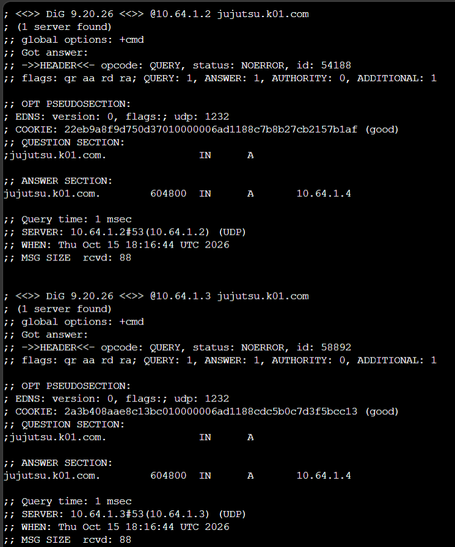
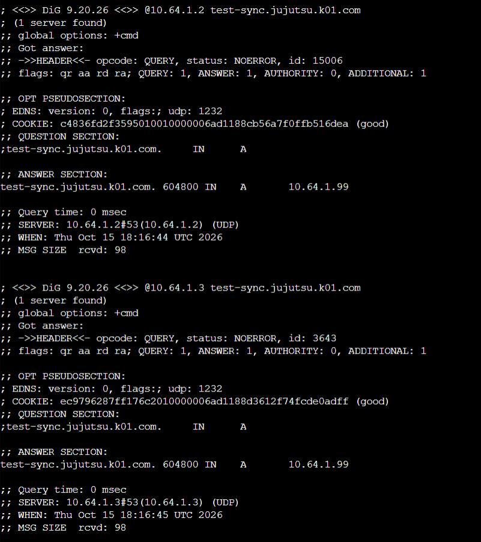
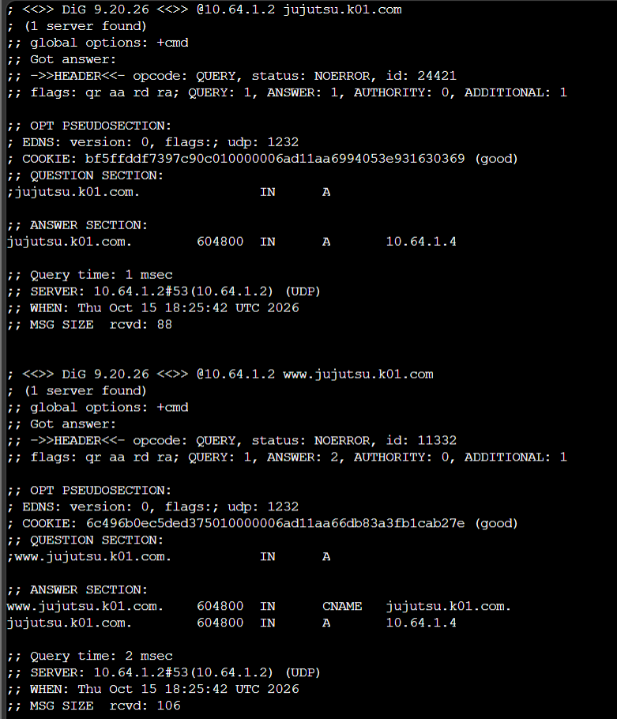
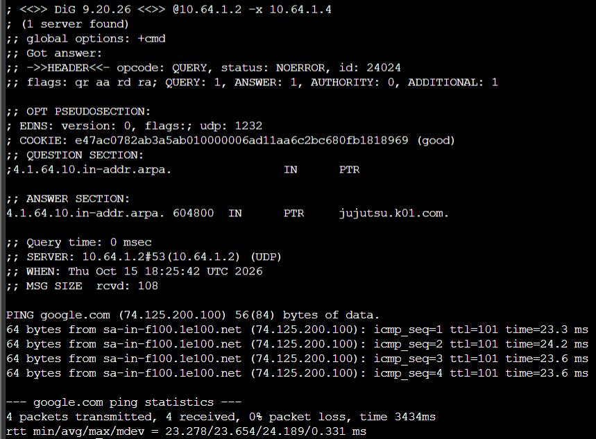
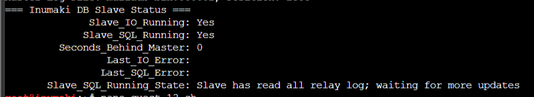
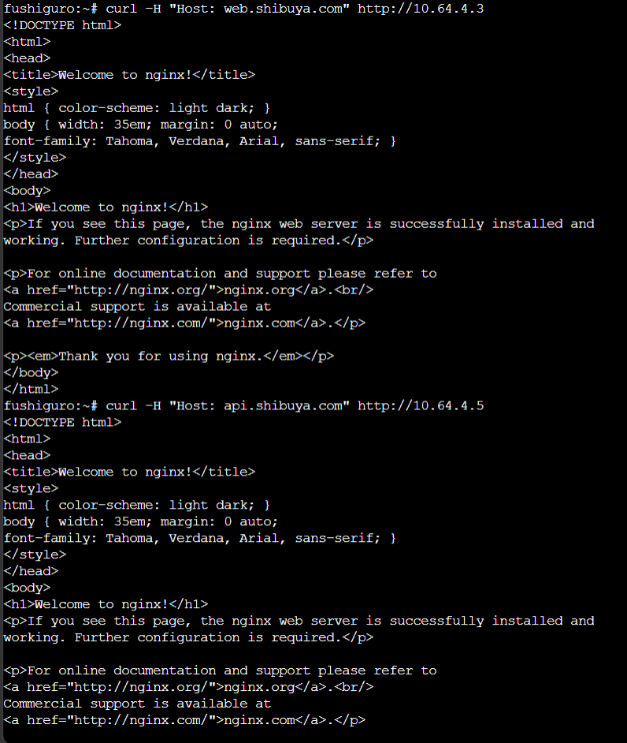
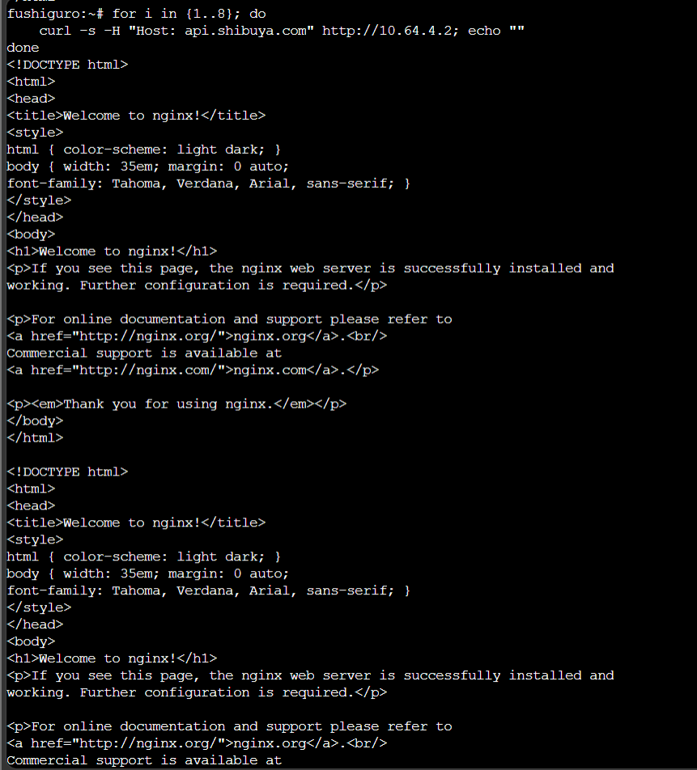

# JARKOM MODUL 3 2026 - K01

## Member

| Nama | NRP |
| --- | --- |
| Umar | 5027251005 |
| Syarifah Nailatur Rohma | 5027251109 |

## Laporan

### Topologi


`jichi` berfungsi sebagai router utama yang menghubungkan interface WAN menuju NAT serta empat segmen jaringan internal. Prefix IP kelompok yang digunakan adalah `10.64.x.x` dengan subnet mask `/24`.

| Segmen | Interface jichi | Gateway | Entitas |
| --- | --- | --- | --- |
| 10.64.1.0/24 | eth1 | 10.64.1.1 | utahime (1.2), shoko (1.3), gojo (1.4) |
| 10.64.2.0/24 | eth2 | 10.64.2.1 | itadori, fushiguro, zenin, okkotsu |
| 10.64.3.0/24 | eth3 | 10.64.3.1 | ino, kusakabe, miwa, kugisaki |
| 10.64.4.0/24 | eth4 | 10.64.4.1 | tengen (4.10), geto (4.2), worker & database |

Daftar entitas dan peran jaringan:

| Entitas | Peran | Tipe Konfigurasi IP | Alokasi / Rentang IP |
| --- | --- | --- | --- |
| **jichi** | Router Utama & DHCP Relay | DHCP (WAN) / Statis (LAN) | eth0 WAN, eth1–eth4 `10.64.[1-4].1` |
| **tengen** | DHCP Server | Statis | `10.64.4.10/24` |
| **utahime** | DNS Master | Statis | `10.64.1.2/24` |
| **shoko** | DNS Slave | Statis | `10.64.1.3/24` |
| **gojo** | Public Reverse Proxy | Statis | `10.64.1.4/24` |
| **geto** | Internal Load Balancer | Statis | `10.64.4.2/24` |
| **itadori, fushiguro** | Klien Divisi A (Dev Team) | Dinamis (Pool 1) | `10.64.2.10` – `10.64.2.35` |
| **zenin, okkotsu** | Klien Divisi A (Support Team) | Dinamis (Pool 2) | `10.64.2.70` – `10.64.2.95` |
| **ino, kusakabe** | Klien Divisi B (Short Lease) | Dinamis (Short Lease 30m) | `10.64.3.10` – `10.64.3.89` |
| **miwa** | Klien Divisi B (Long Lease) | Dinamis (Long Lease 12h) | `10.64.3.100` – `10.64.3.199` |
| **kugisaki** | Klien Divisi B (VIP) | DHCP Static / Fixed Address | `10.64.3.99/24` |
| **maki** | Worker Frontend 1 | Statis | `10.64.4.3/24` |
| **panda** | Worker Frontend 2 | Statis | `10.64.4.4/24` |
| **nanami** | Worker API Utama 1 | Statis | `10.64.4.5/24` |
| **todo** | Worker API Utama 2 | Statis | `10.64.4.6/24` |
| **kirara** | Worker API Cadangan | Statis | `10.64.4.7/24` |
| **yaga** | Database Master MariaDB | Statis | `10.64.4.11/24` |
| **inumaki** | Database Slave MariaDB | Statis | `10.64.4.12/24` |

---

### 1. Konfigurasi Dasar Router jichi dan Host Infrastruktur

`jichi` dikonfigurasi agar interface `eth0` memperoleh alamat WAN dari NAT melalui DHCP, sedangkan `eth1` sampai `eth4` bertindak sebagai gateway untuk masing-masing segmen internal. IPv4 forwarding dan NAT masquerade diaktifkan agar jaringan internal dapat mengakses internet.

Konfigurasi antarmuka dan NAT pada `nodes/jichi/init.sh`:

```bash
cat <<EOF > /etc/network/interfaces
auto eth0
iface eth0 inet dhcp

auto eth1
iface eth1 inet static
    address 10.64.1.1
    netmask 255.255.255.0

auto eth2
iface eth2 inet static
    address 10.64.2.1
    netmask 255.255.255.0

auto eth3
iface eth3 inet static
    address 10.64.3.1
    netmask 255.255.255.0

auto eth4
iface eth4 inet static
    address 10.64.4.1
    netmask 255.255.255.0
EOF

cat <<EOF > /etc/resolv.conf
nameserver 192.168.122.1
EOF

# Quest 1
sysctl -w net.ipv4.ip_forward=1
iptables -t nat -A POSTROUTING -o eth0 -j MASQUERADE

iptables -A FORWARD -i eth1 -o eth0 -j ACCEPT
iptables -A FORWARD -i eth2 -o eth0 -j ACCEPT
iptables -A FORWARD -i eth3 -o eth0 -j ACCEPT
iptables -A FORWARD -i eth4 -o eth0 -j ACCEPT
iptables -A FORWARD -m state --state ESTABLISHED,RELATED -j ACCEPT
```

Host infrastruktur dikonfigurasi dengan IP statis dan gateway `jichi` yang sesuai. Contoh konfigurasi pada `nodes/tengen/init.sh`:

```bash
cat <<EOF > /etc/network/interfaces
auto eth0
iface eth0 inet static
    address 10.64.4.10
    netmask 255.255.255.0
    gateway 10.64.4.1
EOF

cat <<EOF > /etc/resolv.conf
nameserver 192.168.122.1
EOF
```

Pengujian konektivitas dilakukan dengan memeriksa alamat interface pada `jichi`, lalu melakukan ping ke gateway dan internet dari host infrastruktur:

- Cek alamat interface `jichi`:


- Cek konektivitas ke gateway `jichi` dari `tengen`:


---

### 2. Konfigurasi DHCP Server pada tengen

Layanan `isc-dhcp-server` dipasang pada `tengen` (`10.64.4.10`). Karena interface `eth0` tengen berada di subnet `10.64.4.0/24`, deklarasi subnet lokal tanpa dynamic pool didefinisikan agar service tidak mengalami error *No subnet declaration*.

Interface yang mendengarkan paket ditentukan pada `/etc/default/isc-dhcp-server`:

```bash
INTERFACESv4="eth0"
INTERFACESv6=""
```

Deklarasi subnet lokal pada `/etc/dhcp/dhcpd.conf`:

```text
subnet 10.64.4.0 netmask 255.255.255.0 {
}
```

Script konfigurasi DHCP server dijalankan dari `nodes/tengen/quest-2.sh`:

Pengujian dilakukan dengan memeriksa status service `isc-dhcp-server` di tengen:

- Cek status service:


- Cek IP dari client `itadori`, `fushiguro`, `zenin`, `okkotsu`:

```bash
killall udhcpc 2>/dev/null
udhcpc -i eth0 -n -q
ip -br addr show eth0

# Expected output:
itadori   -> 10.64.2.10 - 10.64.2.35
fushiguro -> 10.64.2.10 - 10.64.2.35
zenin     -> 10.64.2.70 - 10.64.2.95
okkotsu   -> 10.64.2.70 - 10.64.2.95
```


---

### 3. Konfigurasi DHCP Relay pada jichi

Karena request DHCP dikirim secara broadcast dan terhalang oleh router, `jichi` dikonfigurasi sebagai DHCP Relay menuju `tengen` (`10.64.4.10`). Relay mendengarkan request dari Network 2 (`eth2`) dan Network 3 (`eth3`), lalu meneruskannya melalui `eth4`.

Konfigurasi DHCP relay dijalankan dari `nodes/jichi/quest-3.sh`:

```bash
# Quest 3
apt-get update
apt-get install -y isc-dhcp-relay

cat <<EOF > /etc/default/isc-dhcp-relay
SERVERS="10.64.4.10"
INTERFACES="eth2 eth3 eth4"
OPTIONS=""
EOF

service isc-dhcp-relay restart
pkill dhcrelay 2>/dev/null || true
dhcrelay -4 -i eth2 -i eth3 -i eth4 10.64.4.10 >/var/log/dhcrelay.log 2>&1 &
```

Pengujian dilakukan dengan memastikan proses `dhcrelay` berjalan pada `jichi`:

- jichi relay status:


- Cek IP dari client `itadori (network 2)`, `ino (network 3)`:


---

### 4. Pembagian Pool Network 2 Berdasarkan DHCP Class

Untuk memisahkan jatah alamat antara Dev Team (`itadori`, `fushiguro`) dan Support Team (`zenin`, `okkotsu`) di subnet yang sama (`10.64.2.0/24`), digunakan DHCP class berdasarkan MAC address. Rentang `10.64.2.36` sampai `10.64.2.69` sengaja tidak dialokasikan.

Konfigurasi kelas dan pool pada `/etc/dhcp/dhcpd.conf`:

```text
class "dev-team" {
    match if (
        hardware = 01:02:42:10:96:32:00 or
        hardware = 01:02:42:82:01:ad:00
    );
}

class "support-team" {
    match if (
        hardware = 01:02:42:03:be:c4:00 or
        hardware = 01:02:42:7a:e9:57:00
    );
}

subnet 10.64.2.0 netmask 255.255.255.0 {
    option routers 10.64.2.1;
    option broadcast-address 10.64.2.255;
    option domain-name-servers 10.64.1.2, 10.64.1.3;
    option domain-name "k01.com";

    pool {
        allow members of "dev-team";
        range 10.64.2.10 10.64.2.35;
    }

    pool {
        allow members of "support-team";
        range 10.64.2.70 10.64.2.95;
    }
}
```

Pengujian dilakukan dengan menjalankan `udhcpc` pada masing-masing client Network 2:


`itadori` memperoleh `10.64.2.10`, `fushiguro` memperoleh `10.64.2.11`, sedangkan `zenin` memperoleh `10.64.2.70` dan `okkotsu` memperoleh `10.64.2.71`.

---

### 5. Pengaturan Lease Time pada Network 3

Pada Network 3 (`10.64.3.0/24`), durasi sewa dibedakan antara short lease 30 menit (1800 detik) untuk `ino` dan `kusakabe`, serta long lease 12 jam (43200 detik) untuk `miwa`.

Konfigurasi pool pada `/etc/dhcp/dhcpd.conf`:

```text
class "short-lease-clients" {
    match if (
        hardware = 01:02:42:8c:dc:78:00 or
        hardware = 01:02:42:4b:2b:85:00
    );
}

class "long-lease-clients" {
    match if (
        hardware = 01:02:42:39:9b:53:00
    );
}

subnet 10.64.3.0 netmask 255.255.255.0 {
    option routers 10.64.3.1;
    option broadcast-address 10.64.3.255;
    option domain-name-servers 10.64.1.2, 10.64.1.3;
    option domain-name "k01.com";

    pool {
        allow members of "short-lease-clients";
        range 10.64.3.10 10.64.3.89;
        default-lease-time 1800;
        max-lease-time 1800;
    }

    pool {
        allow members of "long-lease-clients";
        range 10.64.3.100 10.64.3.199;
        default-lease-time 43200;
        max-lease-time 43200;
    }
}
```

Pengujian dilakukan dengan memeriksa output `udhcpc` saat perolehan lease:

- ino


- kusakabe


- miwa


`ino` dan `kusakabe` memperoleh lease time 1800 detik pada rentang `.3.10–.3.89`, sedangkan `miwa` memperoleh lease time 43200 detik pada rentang `.3.100–.3.199`.

- verifikasi database lease pada `tengen`:


---

### 6. Fixed Address untuk Kugisaki

`kugisaki` ditetapkan sebagai host VIP yang menerima fixed address `10.64.3.99` berdasarkan MAC address `02:42:91:6d:8c:00`. Alamat ini berada di luar rentang pool dinamis short lease dan long lease.

Konfigurasi host pada `/etc/dhcp/dhcpd.conf`:

```text
host kugisaki {
    hardware ethernet 02:42:91:6d:8c:00;
    fixed-address 10.64.3.99;
    option routers 10.64.3.1;
    option domain-name-servers 10.64.1.2, 10.64.1.3;
    option domain-name "k01.com";
}
```

Pengujian dilakukan dengan memperbarui lease pada `kugisaki`:


`kugisaki` selalu memperoleh alamat statis `10.64.3.99`.

---

### 7. Validasi Konfigurasi Jaringan Client dan Database Lease

Setiap client menerima parameter jaringan berupa netmask `/24`, default gateway ke router `jichi`, nameserver `10.64.1.2` dan `10.64.1.3`, serta domain search `k01.com`.

Konfigurasi pada client Alpine diatur pada `init.sh`:

```bash
cat <<EOF > /etc/network/interfaces
auto eth0
iface eth0 inet dhcp
EOF

killall udhcpc 2>/dev/null
udhcpc -i eth0 -n -q
```

Pemeriksaan dilakukan dengan melihat `ip route`, `/etc/resolv.conf` pada client, serta file `/var/lib/dhcp/dhcpd.leases` pada `tengen`:


Database sewa mencatat seluruh client dengan IP, status binding aktif, dan waktu sewa yang sesuai tanpa ada alamat yang bertabrakan.

---

### 8. Analisis Paket Pertukaran DHCP (DORA)

Proses perolehan alamat diuji dengan menangkap paket DHCP pada interface `eth0` `tengen` menggunakan `tcpdump`:

```bash
tcpdump -i eth0 -n -vvv "port 67 or port 68"
```


Hasil penangkapan paket menunjukkan urutan empat tahap:
1. **DHCPDISCOVER**: Klien meminta konfigurasi, diteruskan oleh relay `jichi` dengan field `giaddr = 10.64.2.1`.
2. **DHCPOFFER**: Server `tengen` menawarkan IP dari pool yang sesuai.
3. **DHCPREQUEST**: Klien meminta sewa resmi terhadap penawaran tersebut.
4. **DHCPACK**: Server mengonfirmasi dan memberikan lease beserta opsi jaringan.

---

### 9. Pengujian Gangguan dan Pemulihan DHCP Relay

Pengujian dilakukan untuk membuktikan dampak terputusnya jalur relay antara client dan server. Layanan relay pada `jichi` dihentikan sementara menggunakan `nodes/jichi/quest-9.sh stop`.

Saat relay berhenti, permintaan lease baru pada client mengalami kegagalan:

```text
udhcpc: started, v1.37.0
udhcpc: broadcasting discover
udhcpc: broadcasting discover
udhcpc failed to get a DHCP lease
udhcpc: no lease, failing
```

Setelah relay dipulihkan kembali menggunakan `nodes/jichi/quest-9.sh start`, client kembali dapat memperoleh lease sesuai pool asalnya beserta default gateway semula:


---

### 10. Autostart Layanan Pasca-Restart

Pada image GNS3 yang digunakan, `/root/init.sh` dikonfigurasi sebagai startup
script node. Karena itu, setelah `jichi` atau `tengen` direstart, `init.sh`
akan dijalankan otomatis.

Konfigurasi pada `nodes/jichi/init.sh` mengaktifkan kembali interface,
forwarding, NAT, dan DHCP relay. Konfigurasi pada `nodes/tengen/init.sh`
mengaktifkan kembali alamat IP serta DHCP server

Pengujian dilakukan dengan me-restart kedua node, kemudian memeriksa service:

```bash
# Pada jichi
ps aux | grep '[d]hcrelay'
sysctl net.ipv4.ip_forward

# Pada tengen
service isc-dhcp-server status
ps aux | grep '[d]hcpd'
```

Setelah kedua node direstart, seluruh interface, routing NAT, DHCP relay, dan
DHCP server kembali aktif secara otomatis tanpa perlu menjalankan script
tambahan.

- verifikasi status service setelah restart:


### 11. Konfigurasi DNS Server Master-Slave (Zone Transfer & Replikasi)

Membangun infrastruktur DNS Server redundan menggunakan arsitektur Master-Slave pada domain `jujutsu.k01.com`.
* Node **`utahime`** (`10.64.1.2`) bertindak sebagai **Master DNS Server**, mengelola berkas zona otoritatif dan mengizinkan transfer zona hanya ke IP node **`shoko`** (`10.64.1.3`).
* Node **`shoko`** (`10.64.1.3`) bertindak sebagai **Slave DNS Server**, menerima replikasi berkas zona dan menyimpannya secara lokal di `/var/cache/bind/db.jujutsu`.
* Node **`fushiguro`** bertindak sebagai **Node Pengujian** yang memverifikasi kedua DNS server meresolusi domain utama dan record sinkronisasi dengan benar.

#### Konfigurasi Script

* **Node `utahime` (`nodes/utahime/quest-11.sh`):**

```bash
#!/bin/bash

apt-get update
apt-get install -y bind9 bind9utils
mkdir -p /etc/bind

cat << 'EOF' > /etc/bind/named.conf.options
options {
    directory "/var/cache/bind";
    forwarders {
        192.168.122.1;
    };
    allow-query { any; };
    auth-nxdomain no;
    listen-on { any; };
    listen-on-v6 { any; };
};
EOF

cat << 'EOF' > /etc/bind/named.conf.local
zone "jujutsu.k01.com" {
    type master;
    file "/etc/bind/db.jujutsu";
    allow-transfer { 10.64.1.3; };
    also-notify { 10.64.1.3; };
    notify yes;
};
EOF

cat << 'EOF' > /etc/bind/db.jujutsu
$TTL    604800
@       IN      SOA     utahime.jujutsu.k01.com. admin.jujutsu.k01.com. (
                              2026101501 ; Serial
                                  604800 ; Refresh
                                   86400 ; Retry
                                 2419200 ; Expire
                                  604800 ) ; Negative Cache TTL
;
@       IN      NS      utahime.jujutsu.k01.com.
@       IN      NS      shoko.jujutsu.k01.com.

utahime   IN      A       10.64.1.2
shoko     IN      A       10.64.1.3
ns1       IN      A       10.64.1.2
ns2       IN      A       10.64.1.3
@         IN      A       10.64.1.4
test-sync IN      A       10.64.1.99
EOF

named-checkconf
named-checkzone jujutsu.k01.com /etc/bind/db.jujutsu

service named restart || /etc/init.d/named restart || named
```

* **Node `shoko` (`nodes/shoko/quest-11.sh`):**

```bash
#!/bin/bash

apt-get update
apt-get install -y bind9 bind9utils
mkdir -p /etc/bind

cat << 'EOF' > /etc/bind/named.conf.options
options {
    directory "/var/cache/bind";
    forwarders {
        192.168.122.1;
    };
    allow-query { any; };
    auth-nxdomain no;
    listen-on { any; };
    listen-on-v6 { any; };
};
EOF

cat << 'EOF' > /etc/bind/named.conf.local
zone "jujutsu.k01.com" {
    type slave;
    masters { 10.64.1.2; };
    file "/var/cache/bind/db.jujutsu";
};
EOF

named-checkconf
service named restart || /etc/init.d/named restart || named
```

* **Node Pengujian: `fushiguro` (`nodes/fushiguro/quest-11.sh`):**

```bash
#!/bin/sh
dig @10.64.1.2 jujutsu.k01.com
dig @10.64.1.3 jujutsu.k01.com
dig @10.64.1.2 test-sync.jujutsu.k01.com
dig @10.64.1.3 test-sync.jujutsu.k01.com
```

#### Pengujian dan Bukti Screenshot

Pengujian hanya diambil langsung dari node pengujian **`fushiguro`** dengan menjalankan `quest-11.sh`:

* **Uji Resolusi DNS Otoritatif Master & Slave dari Klien `fushiguro`:**
  
  
  


---

### 12. Reverse DNS (PTR Record), Alias CNAME, dan DNS Forwarding

Menyempurnakan konfigurasi DNS Server `jujutsu.k01.com` dengan:
1. Menambahkan record alias `www.jujutsu.k01.com` (`CNAME`) yang merujuk ke domain kanonikal `jujutsu.k01.com.`.
2. Mengonfigurasi **Reverse DNS Zone** (`1.64.10.in-addr.arpa`) untuk memetakan IP reverse proxy `10.64.1.4` kembali ke hostname domainnya (`PTR jujutsu.k01.com.`).
3. Mengonfigurasi forwarder DNS upstream ke IP gateway NAT `192.168.122.1` sehingga client internal dapat meresolusi domain publik internet.

#### Konfigurasi Script

* **Node `utahime` (`nodes/utahime/quest-12.sh`):**

```bash
#!/bin/bash

cat << 'EOF' > /etc/bind/named.conf.options
options {
    directory "/var/cache/bind";
    forwarders {
        192.168.122.1;
    };
    allow-query { any; };
    auth-nxdomain no;
    listen-on { any; };
    listen-on-v6 { any; };
};
EOF

cat << 'EOF' > /etc/bind/named.conf.local
zone "jujutsu.k01.com" {
    type master;
    file "/etc/bind/db.jujutsu";
    allow-transfer { 10.64.1.3; };
    also-notify { 10.64.1.3; };
    notify yes;
};

zone "1.64.10.in-addr.arpa" {
    type master;
    file "/etc/bind/db.10.64.1";
    allow-transfer { 10.64.1.3; };
    also-notify { 10.64.1.3; };
    notify yes;
};
EOF

cat << 'EOF' > /etc/bind/db.jujutsu
$TTL    604800
@       IN      SOA     utahime.jujutsu.k01.com. admin.jujutsu.k01.com. (
                              2026101502 ; Serial dinaikkan
                                  604800 ; Refresh
                                   86400 ; Retry
                                 2419200 ; Expire
                                  604800 ) ; Negative Cache TTL
;
@       IN      NS      utahime.jujutsu.k01.com.
@       IN      NS      shoko.jujutsu.k01.com.

utahime   IN      A       10.64.1.2
shoko     IN      A       10.64.1.3
ns1       IN      A       10.64.1.2
ns2       IN      A       10.64.1.3

@         IN      A       10.64.1.4
www       IN      CNAME   jujutsu.k01.com.
test-sync IN      A       10.64.1.99
EOF

cat << 'EOF' > /etc/bind/db.10.64.1
$TTL    604800
@       IN      SOA     utahime.jujutsu.k01.com. admin.jujutsu.k01.com. (
                              2026101502 ; Serial
                                  604800
                                   86400
                                 2419200
                                  604800 )
;
@       IN      NS      utahime.jujutsu.k01.com.
@       IN      NS      shoko.jujutsu.k01.com.

4       IN      PTR     jujutsu.k01.com.
EOF

named-checkconf
named-checkzone jujutsu.k01.com /etc/bind/db.jujutsu
named-checkzone 1.64.10.in-addr.arpa /etc/bind/db.10.64.1

rndc reload || service named restart || /etc/init.d/named restart || named
```

* **Node `shoko` (`nodes/shoko/quest-12.sh`):**

```bash
#!/bin/bash

cat << 'EOF' > /etc/bind/named.conf.options
options {
    directory "/var/cache/bind";
    forwarders {
        192.168.122.1;
    };
    allow-query { any; };
    auth-nxdomain no;
    listen-on { any; };
    listen-on-v6 { any; };
};
EOF

cat << 'EOF' > /etc/bind/named.conf.local
zone "jujutsu.k01.com" {
    type slave;
    masters { 10.64.1.2; };
    file "/var/cache/bind/db.jujutsu";
};

zone "1.64.10.in-addr.arpa" {
    type slave;
    masters { 10.64.1.2; };
    file "/var/cache/bind/db.10.64.1";
};
EOF

named-checkconf
rndc reload || service named restart || /etc/init.d/named restart || named
```

* **Node Pengujian: `fushiguro` (`nodes/fushiguro/quest-12.sh`):**

```bash
#!/bin/sh
dig @10.64.1.2 jujutsu.k01.com
dig @10.64.1.2 www.jujutsu.k01.com
dig @10.64.1.2 -x 10.64.1.4

echo "nameserver 10.64.1.2" > /etc/resolv.conf
ping -c 4 google.com
```

#### Pengujian dan Bukti Screenshot

Pengujian seluruh fungsionalitas (resolusi record A, record alias CNAME, PTR reverse pointer, dan forwarding internet) diambil langsung dari satu layar eksekusi node pengujian **`fushiguro`**:

* **Eksekusi Pengujian Terpadu pada Node `fushiguro`:**
  
  
  


---

### 13. MariaDB Master-Slave Database Replication dan Remote Access

Membangun arsitektur kluster database MariaDB dengan skema Master-Slave:
* **Master (`yaga` - `10.64.4.11`)**: Mengaktifkan binary logging (`mariadb-bin.log`), mereplikasi hanya database `db_shibuya_k01`, membuat tabel `request_logs`, serta memberikan hak replikasi kepada user `replica` dan grant remote access untuk subnet `10.64.4.%`.
* **Slave (`inumaki` - `10.64.4.12`)**: Mengambil posisi file log Master secara otomatis dan mengaktifkan thread replikasi slave.

#### Konfigurasi Script

* **Node `yaga` (`nodes/yaga/quest-13.sh`):**

```bash
#!/bin/bash
set -e

apt-get update
apt-get install -y mariadb-server

mkdir -p /var/log/mysql
chown -R mysql:mysql /var/log/mysql

sed -i 's/^bind-address\s*=.*/bind-address = 0.0.0.0/' /etc/mysql/mariadb.conf.d/50-server.cnf
sed -i 's/^#*server-id\s*=.*/server-id = 1/' /etc/mysql/mariadb.conf.d/50-server.cnf
sed -i 's|^#*log_bin\s*=.*|log_bin = /var/log/mysql/mariadb-bin.log|' /etc/mysql/mariadb.conf.d/50-server.cnf

grep -q "server-id = 1" /etc/mysql/mariadb.conf.d/50-server.cnf || sed -i '/\[mysqld\]/a server-id = 1\nlog_bin = /var/log/mysql/mariadb-bin.log\nbinlog_do_db = db_shibuya_k01' /etc/mysql/mariadb.conf.d/50-server.cnf
grep -q "binlog_do_db = db_shibuya_k01" /etc/mysql/mariadb.conf.d/50-server.cnf || sed -i '/log_bin =/a binlog_do_db = db_shibuya_k01' /etc/mysql/mariadb.conf.d/50-server.cnf

service mariadb restart

mariadb -u root <<EOF
CREATE DATABASE IF NOT EXISTS db_shibuya_k01;
USE db_shibuya_k01;

DROP TABLE IF EXISTS request_logs;
CREATE TABLE request_logs (
    id INT AUTO_INCREMENT PRIMARY KEY,
    worker_name VARCHAR(50),
    client_ip VARCHAR(50),
    proxy_ip VARCHAR(50),
    user_agent TEXT,
    pesan VARCHAR(255),
    created_at TIMESTAMP DEFAULT CURRENT_TIMESTAMP
);

CREATE USER IF NOT EXISTS 'replica'@'%' IDENTIFIED BY 'replica123';
GRANT REPLICATION SLAVE, REPLICATION CLIENT ON *.* TO 'replica'@'%';

CREATE USER IF NOT EXISTS 'admin_shibuya'@'10.64.4.%' IDENTIFIED BY 'admin123';
GRANT ALL PRIVILEGES ON db_shibuya_k01.* TO 'admin_shibuya'@'10.64.4.%';
CREATE USER IF NOT EXISTS 'root'@'10.64.4.%' IDENTIFIED BY 'admin123';
GRANT ALL PRIVILEGES ON *.* TO 'root'@'10.64.4.%' WITH GRANT OPTION;

FLUSH PRIVILEGES;
EOF

echo "=== Yaga DB Master Status ==="
mariadb -u root -e "SHOW MASTER STATUS\G"
```

* **Node `inumaki` (`nodes/inumaki/quest-13.sh`):**

```bash
#!/bin/bash
set -e

apt-get update
apt-get install -y mariadb-server

mkdir -p /var/log/mysql
chown -R mysql:mysql /var/log/mysql

sed -i 's/^bind-address\s*=.*/bind-address = 0.0.0.0/' /etc/mysql/mariadb.conf.d/50-server.cnf
sed -i 's/^#*server-id\s*=.*/server-id = 2/' /etc/mysql/mariadb.conf.d/50-server.cnf
grep -q "server-id = 2" /etc/mysql/mariadb.conf.d/50-server.cnf || sed -i '/\[mysqld\]/a server-id = 2' /etc/mysql/mariadb.conf.d/50-server.cnf

service mariadb restart

MASTER_IP="10.64.4.11"
STATUS_OUT=$(mariadb -h "$MASTER_IP" -u replica -preplica123 -e "SHOW MASTER STATUS\G")
LOG_FILE=$(echo "$STATUS_OUT" | grep "File:" | awk '{print $2}')
LOG_POS=$(echo "$STATUS_OUT" | grep "Position:" | awk '{print $2}')

echo "Master Log File: $LOG_FILE, Position: $LOG_POS"

mariadb -u root <<EOF
STOP SLAVE;
CHANGE MASTER TO
    MASTER_HOST='$MASTER_IP',
    MASTER_USER='replica',
    MASTER_PASSWORD='replica123',
    MASTER_LOG_FILE='$LOG_FILE',
    MASTER_LOG_POS=$LOG_POS;
START SLAVE;
EOF

echo "=== Inumaki DB Slave Status ==="
mariadb -u root -e "SHOW SLAVE STATUS\G" | grep -E "Slave_IO_Running|Slave_SQL_Running|Seconds_Behind_Master|Last_IO_Error|Last_SQL_Error"
```

#### Pengujian dan Bukti Screenshot

Karena nomor ini merupakan inisialisasi basis data dan replikasi antar-server (tanpa node klien eksternal), pengujian diverifikasi dari output status slave di node **`inumaki`**:

* **Verifikasi Status Replikasi Slave pada Node `inumaki`:**
  
  


---

### 14. Konfigurasi Worker Node (Frontend PHP dan API Logger)

Menyiapkan kluster worker aplikasi web:
* **Frontend Web Worker (`maki`, `panda`)**: Menjalankan Nginx + PHP-FPM, menampilkan nama worker, dan membatasi akses (`allow 10.64.1.4; deny all;`) agar hanya dapat diakses melalui reverse proxy `gojo` atau localhost.
* **Backend API Worker (`nanami`, `todo`)**: Menjalankan endpoint `/` dan `/api` untuk mencatat request log ke server database `yaga` (`10.64.4.11`), dan membatasi akses (`allow 10.64.4.2; deny all;`) agar hanya dapat diakses melalui load balancer `geto` atau localhost.

#### Konfigurasi Script

* **Node `panda` & `maki` (`nodes/panda/quest-14.sh`):**

```bash
#!/bin/bash
set -e

printf '#!/bin/sh\nexit 0\n' > /usr/sbin/policy-rc.d

apt-get update
apt-get install -y nginx php-fpm

rm -f /var/www/html/index.html
cat << 'EOF' > /var/www/html/index.php
<?php
echo "Response dari Frontend Worker: " . gethostname() . "\n";
?>
EOF

cat << 'EOF' > /etc/nginx/sites-available/default
server {
    listen 80 default_server;
    server_name jujutsu.k01.com www.jujutsu.k01.com web.shibuya.com _;

    allow 10.64.1.4;
    allow 127.0.0.1;
    deny all;

    root /var/www/html;
    index index.php index.html;

    location / {
        try_files $uri $uri/ =404;
    }

    location ~ \.php$ {
        include snippets/fastcgi-php.conf;
        fastcgi_pass unix:/run/php/php8.4-fpm.sock;
    }
}
EOF

service php*-fpm restart
service nginx restart
echo "Setup Web Worker Selesai!"
```

* **Node `todo` & `nanami` (`nodes/todo/quest-14.sh`):**

```bash
#!/bin/bash
set -e

printf '#!/bin/sh\nexit 0\n' > /usr/sbin/policy-rc.d

apt-get update
apt-get install -y nginx php-fpm php-mysql

rm -f /var/www/html/index.html
cat << 'EOF' > /var/www/html/index.php
<?php
header('Content-Type: application/json');

$host = '10.64.4.11';
$db   = 'db_shibuya_k01';
$user = 'admin_shibuya';
$pass = 'admin123';

$conn = new mysqli($host, $user, $pass, $db);
if ($conn->connect_error) {
    echo json_encode(["status" => "error", "message" => "Koneksi ke DB Yaga gagal: " . $conn->connect_error]);
    exit();
}

$hostname  = gethostname();
$client_ip = $_SERVER['HTTP_X_REAL_IP'] ?? $_SERVER['HTTP_X_FORWARDED_FOR'] ?? $_SERVER['REMOTE_ADDR'];
$proxy_ip  = $_SERVER['REMOTE_ADDR'];
$user_agent= $_SERVER['HTTP_USER_AGENT'] ?? '';
$pesan     = "Request API berhasil diproses oleh node: " . $hostname;

$stmt = $conn->prepare("INSERT INTO request_logs (worker_name, client_ip, proxy_ip, user_agent, pesan) VALUES (?, ?, ?, ?, ?)");
$stmt->bind_param("sssss", $hostname, $client_ip, $proxy_ip, $user_agent, $pesan);

if ($stmt->execute()) {
    echo json_encode([
        "status"      => "success",
        "worker_name" => $hostname,
        "client_ip"   => $client_ip,
        "proxy_ip"    => $proxy_ip,
        "message"     => "Log berhasil dicatat di database Yaga"
    ]);
} else {
    echo json_encode(["status" => "error", "message" => "Gagal mencatat log: " . $conn->error]);
}

$stmt->close();
$conn->close();
?>
EOF

ln -sf /var/www/html /var/www/html/api

cat << 'EOF' > /etc/nginx/sites-available/default
server {
    listen 80 default_server;
    server_name jujutsu.k01.com www.jujutsu.k01.com api.shibuya.com _;

    allow 10.64.4.2;
    allow 127.0.0.1;
    deny all;

    root /var/www/html;
    index index.php index.html;

    location / {
        try_files $uri $uri/ /index.php?$args;
    }

    location ~ \.php$ {
        include snippets/fastcgi-php.conf;
        fastcgi_pass unix:/run/php/php8.4-fpm.sock;
    }
}
EOF

service php*-fpm restart
service nginx restart
echo "Setup API Worker Selesai!"
```

#### Pengujian dan Bukti Screenshot

Pengujian proteksi ACL diuji langsung dari node pengujian **`fushiguro`** dengan mengakses worker secara direct (tanpa lewat proxy yang diizinkan):

* **Uji Akses Langsung (Direct Access Denied) dari Klien `fushiguro`:**
  
  


---

### 15. Nginx Load Balancer dengan Weighted Round Robin

Node **`geto`** (`10.64.4.2`) dikonfigurasi sebagai Load Balancer untuk mendistribusikan lalu lintas ke cluster API worker dengan bobot:
* `nanami` (`10.64.4.5`) dengan `weight=3`
* `todo` (`10.64.4.6`) dengan `weight=1`

Pengujian beban dijalankan dari node pengujian **`fushiguro`** menggunakan skrip `Test-Soal-15.sh`.

#### Konfigurasi Script

* **Node `geto` (`nodes/geto/Soal-15.sh`):**

```bash
#!/bin/bash

printf '#!/bin/sh\nexit 0\n' > /usr/sbin/policy-rc.d
apt-get update
apt-get install -y nginx

cat << 'EOF' > /etc/nginx/sites-available/default
upstream api_cluster {
    server 10.64.4.5 weight=3; # IP nanami
    server 10.64.4.6 weight=1; # IP todo
}

server {
    listen 80;

    location / {
        proxy_pass http://api_cluster;
        proxy_set_header Host api.shibuya.com;
        proxy_set_header X-Real-IP $remote_addr;
    }
}
EOF

service nginx restart
echo "Konfigurasi Load Balancer Geto Selesai!"
```

* **Node Pengujian: `fushiguro` (`nodes/fushiguro/Test-Soal-15.sh`):**

```bash
#!/bin/sh

for i in {1..8}; do 
    curl -s -H "Host: api.shibuya.com" http://10.64.4.2; echo ""
done
```

#### Pengujian dan Bukti Screenshot

Pengujian verifikasi pembagian beban berbobot 3:1 diambil langsung dari eksekusi di node pengujian **`fushiguro`**:

* **Hasil Eksekusi 8 Request dari Klien `fushiguro`:**
  
  


---

### 16. Path-Based Routing dan Reverse Proxy Load Balancer

Node **`gojo`** (`10.64.1.4`) dikonfigurasi sebagai **Public Gateway Reverse Proxy** dengan aturan perutean berbasis path URL:
1. Request ke root path (`/`) didistribusikan ke cluster web frontend (`maki` dan `panda`).
2. Request ke path `/api` dialihkan secara transparan ke Load Balancer API internal `geto` (`10.64.4.2/`).

Pengujian dijalankan dari node pengujian **`fushiguro`** menggunakan skrip `Test-Soal-16-18.sh`.

#### Konfigurasi Script

* **Node `gojo` (`nodes/gojo/Soal-16.sh`):**

```bash
#!/bin/bash

printf '#!/bin/sh\nexit 0\n' > /usr/sbin/policy-rc.d
apt-get update
apt-get install -y nginx

cat << 'EOF' > /etc/nginx/sites-available/default
upstream web_frontend {
    server 10.64.4.3; # Maki
    server 10.64.4.4; # Panda
}

server {
    listen 80;
    server_name jujutsu.k01.com www.jujutsu.k01.com;

    location / {
        proxy_pass http://web_frontend;
        proxy_set_header Host web.shibuya.com;
        proxy_set_header X-Real-IP $remote_addr;
    }

    location /api {
        proxy_pass http://10.64.4.2/;
        proxy_set_header Host api.shibuya.com;
        proxy_set_header X-Real-IP $remote_addr;
    }
}
EOF

service nginx restart
echo "Setup Path-Based Routing di Gojo Selesai!"
```

* **Node Pengujian: `fushiguro` (`nodes/fushiguro/Test-Soal-16-18.sh`):**

```bash
#!/bin/sh

curl -H "Host: jujutsu.k01.com" http://10.64.1.4/
curl -H "Host: jujutsu.k01.com" http://10.64.1.4/

# Soal 16-17
curl -H "Host: jujutsu.k01.com" http://10.64.1.4/api
```

#### Pengujian dan Bukti Screenshot

Pengujian routing root dan endpoint API diambil langsung dari node pengujian **`fushiguro`**:

* **Hasil Pengujian Path-Based Routing dari Klien `fushiguro`:**
  
  


---

### 17. Request Auditing dan Client Real-IP Tracking ke Database

Memastikan data audit lalu lintas mencatat alamat IP asli client saat melewati arsitektur proxy bertingkat (`Client` $\rightarrow$ `Gojo` $\rightarrow$ `Geto` $\rightarrow$ `Worker API`).

#### Konfigurasi Script

* **Node API Worker: `nanami`, `todo`, & `kirara` (`Soal-17.sh`):**

```bash
cat << 'EOF' > /var/www/html/index.php
<?php
header('Content-Type: application/json');

$host = '10.64.4.11';
$db   = 'db_shibuya_k01';
$user = 'admin_shibuya';
$pass = 'admin123';

$conn = new mysqli($host, $user, $pass, $db);
if ($conn->connect_error) {
    echo json_encode(["status" => "error", "message" => "Koneksi DB gagal: " . $conn->connect_error]);
    exit();
}

$hostname = gethostname();
$pesan    = "Request API diproses oleh: " . $hostname;

// Mengambil IP Klien Asli (X-Real-IP) dari header yang diteruskan oleh Geto
$client_ip = isset($_SERVER['HTTP_X_REAL_IP']) ? $_SERVER['HTTP_X_REAL_IP'] : $_SERVER['REMOTE_ADDR'];

$sql = "INSERT INTO request_logs (pesan, client_ip) VALUES ('$pesan', '$client_ip')";

if ($conn->query($sql) === TRUE) {
    echo json_encode([
        "status"      => "success",
        "message"     => "Log dicatat di DB oleh " . $hostname,
        "recorded_ip" => $client_ip
    ]);
} else {
    echo json_encode(["status" => "error", "message" => "Gagal mencatat log: " . $conn->error]);
}

$conn->close();
?>
EOF
```

* **Node Pengujian: `fushiguro` (`nodes/fushiguro/Test-Soal-16-18.sh`):**

```bash
curl -H "Host: jujutsu.k01.com" http://10.64.1.4/api
```

#### Pengujian dan Bukti Screenshot

Pengujian respon audit IP klien asli diambil langsung dari node pengujian **`fushiguro`**:

* **Hasil Respon JSON dengan Recorded IP dari Klien `fushiguro`:**
  
  


---

### 18. High Availability (Passive Health Check, Failover Backup, dan Real-IP Multi-Hop)

Mengimplementasikan ketersediaan tinggi pada Load Balancer `geto`:
1. **Passive Health Check**: Parameter `max_fails=2 fail_timeout=5s` pada worker utama (`nanami` dan `todo`).
2. **Failover Backup Worker**: Node **`kirara`** (`10.64.4.7`) bertindak sebagai worker cadangan (`backup`) yang hanya melayani request saat seluruh worker utama mati.
3. **Modul Real-IP Multi-Hop**: Modul `ngx_http_realip_module` (`set_real_ip_from 10.64.1.4; real_ip_header X-Forwarded-For;`) untuk meneruskan IP klien asli secara transparan.

#### Konfigurasi Script

* **Node `geto` (`nodes/geto/Soal-18.sh`):**

```bash
cat << 'EOF' > /etc/nginx/sites-available/default
upstream api_cluster {
    server 10.64.4.5 weight=3 max_fails=2 fail_timeout=5s; # IP nanami
    server 10.64.4.6 weight=1 max_fails=2 fail_timeout=5s; # IP todo
    server 10.64.4.7 backup; # IP kirara
}

server {
    listen 80;

    set_real_ip_from 10.64.1.4;
    real_ip_header X-Forwarded-For;

    location / {
        proxy_pass http://api_cluster;
        proxy_set_header Host api.shibuya.com;
        proxy_set_header X-Real-IP $remote_addr;
        proxy_set_header X-Forwarded-For $proxy_add_x_forwarded_for;
    }
}
EOF

service nginx restart
```

* **Node Pengujian: `fushiguro` (`nodes/fushiguro/Test-Soal-16-18.sh`):**

```bash
curl -H "Host: jujutsu.k01.com" http://10.64.1.4/api
```

#### Pengujian dan Bukti Screenshot

Setelah mematikan service Nginx pada worker utama (`nanami` dan `todo`), pengujian pembuktian *failover* otomatis ke `kirara` diambil langsung dari node pengujian **`fushiguro`**:

* **Hasil Pengujian Failover ke Worker Cadangan dari Klien `fushiguro`:**
  
  


---

### 19. Edge Caching (Proxy Cache) dan Rate Limiting Traffic Protection

Menerapkan optimasi performa dan mitigasi lonjakan trafik pada Edge Reverse Proxy **`gojo`** (`10.64.1.4`):
1. **Edge Proxy Caching**: Mengaktifkan direktori cache memori `web_cache` dengan masa aktif 10 menit untuk respon kode status `200` dan `302`, serta menyertakan header status `X-Cache-Status`.
2. **API Rate Limiting**: Membatasi laju request pada `/api` maksimal 10 request per detik (`rate=10r/s`) menggunakan zona memori `api_limit`. Request yang melampaui batas akan langsung ditolak dengan kode status HTTP `503`.

Pengujian dijalankan dari node pengujian **`fushiguro`** menggunakan skrip `Test-Soal-19.sh`.

#### Konfigurasi Script

* **Node `gojo` (`nodes/gojo/Soal-19.sh`):**

```bash
#!/bin/bash

mkdir -p /var/cache/nginx
chown -R www-data:www-data /var/cache/nginx

cat << 'EOF' > /etc/nginx/sites-available/default
proxy_cache_path /var/cache/nginx levels=1:2 keys_zone=web_cache:10m max_size=100m inactive=60m use_temp_path=off;

limit_req_zone $binary_remote_addr zone=api_limit:10m rate=10r/s;

upstream web_frontend {
    server 10.64.4.3; # IP maki
    server 10.64.4.4; # IP panda
}

server {
    listen 80;
    server_name jujutsu.k01.com www.jujutsu.k01.com;

    location / {
        proxy_pass http://web_frontend;
        proxy_set_header Host web.shibuya.com;
        proxy_set_header X-Real-IP $remote_addr;
        proxy_set_header X-Forwarded-For $proxy_add_x_forwarded_for;

        proxy_cache web_cache;
        proxy_cache_valid 200 302 10m;
        add_header X-Cache-Status $upstream_cache_status;
    }

    location /api {
        proxy_pass http://10.64.4.2/;
        proxy_set_header Host api.shibuya.com;
        proxy_set_header X-Real-IP $remote_addr;
        proxy_set_header X-Forwarded-For $proxy_add_x_forwarded_for;

        limit_req zone=api_limit;
    }
}
EOF

service nginx restart
echo "Konfigurasi Caching dan Rate Limiting di Gojo Selesai!"
```

* **Node Pengujian: `fushiguro` (`nodes/fushiguro/Test-Soal-19.sh`):**

```bash
#!/bin/sh

# 1. Verifikasi Caching (Request 1 = MISS, Request 2 = HIT)
curl -I -H "Host: jujutsu.k01.com" http://10.64.1.4/
curl -I -H "Host: jujutsu.k01.com" http://10.64.1.4/

# 2. Verifikasi Rate Limiting: 20 request berurutan cepat
for i in {1..20}; do 
    curl -s -o /dev/null -w "Request $i - HTTP Status: %{http_code}\n" -H "Host: jujutsu.k01.com" http://10.64.1.4/api
done
```

#### Pengujian dan Bukti Screenshot

Pengujian cache header (`MISS` $\rightarrow$ `HIT`) serta rate limiting diambil langsung dari satu layar eksekusi node pengujian **`fushiguro`**:

* **Hasil Eksekusi Caching dan Rate Limiting dari Klien `fushiguro`:**
  
  

### 20. Pengujian Beban dan Analisis Performa Arsitektur Web Menggunakan Apache Benchmark

Untuk mengevaluasi ketahanan, stabilitas, dan efektivitas mekanisme keamanan serta caching yang telah diimplementasikan pada arsitektur server, dilakukan uji beban (*stress test / load testing*) menggunakan utilitas **Apache Benchmark (`ab`)**. Pengujian disimulasikan dari node klien penguji terhadap server reverse proxy `gojo` (`10.64.1.4`) dengan parameter beban **600 permintaan** dan tingkat konkurensi **30 koneksi simultan** (`-n 600 -c 30`).

Evaluasi performa ditargetkan pada dua jalur (*path*) berbeda:
1. **Endpoint Frontend (`/`)**: Menguji efektivitas akselerasi **Proxy Caching** (`web_cache`) dalam melayani konten statis/dinamis dari worker frontend (`maki` dan `panda`) tanpa membebani backend.
2. **Endpoint Backend API (`/api`)**: Menguji keandalan mekanisme **Rate Limiting** (`api_limit: 10r/s`) serta dampak perlindungan terhadap kluster worker backend (`nanami`, `todo`, `kirara`) dan basis data `yaga`.

Skrip pengujian diotomatisasi dan dijalankan dari node penguji `fushiguro` melalui berkas `benchmark_soal20.sh`:

```bash
cat << 'EOF' > benchmark_soal20.sh
#!/bin/sh
apk update > /dev/null 2>&1
apk add apache2-utils > /dev/null 2>&1

# 1. Uji Beban Endpoint Frontend Web (Proxy Caching)
ab -n 600 -c 30 -H "Host: jujutsu.k01.com" [http://10.64.1.4/](http://10.64.1.4/)
sleep 2

# 2. Uji Beban Endpoint Backend API (Rate Limiting)
ab -n 600 -c 30 -H "Host: jujutsu.k01.com" [http://10.64.1.4/api](http://10.64.1.4/api)
EOF

chmod +x benchmark_soal20.sh
./benchmark_soal20.sh

```
