# JARKOM MODUL 3 2026 - K01

## Member

| Nama | NRP |
| --- | --- |
| Umar | 5027251005 |
| Syarifah Nailatur Rohma | 5027251109 |

## Laporan

### Topologi

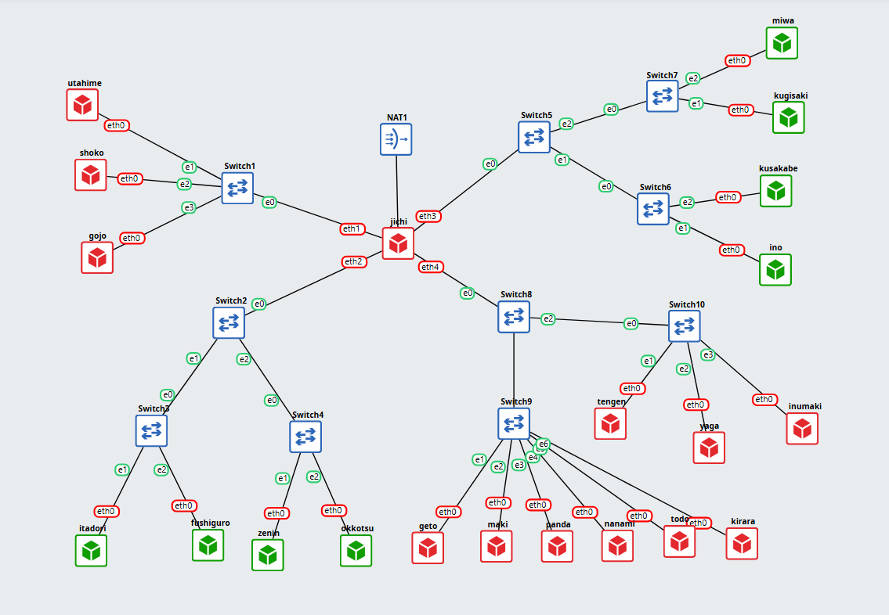

`jichi` berfungsi sebagai router utama yang menghubungkan interface WAN menuju NAT serta empat segmen jaringan internal. Prefix IP kelompok yang digunakan adalah `10.64.x.x` dengan subnet mask `/24`.

| Segmen | Interface jichi | Gateway | Entitas |
| --- | --- | --- | --- |
| 10.64.1.0/24 | eth1 | 10.64.1.1 | utahime (1.2), shoko (1.3), gojo (1.4) |
| 10.64.2.0/24 | eth2 | 10.64.2.1 | itadori, fushiguro, zenin, okkotsu |
| 10.64.3.0/24 | eth3 | 10.64.3.1 | ino, kusakabe, miwa, kugisaki |
| 10.64.4.0/24 | eth4 | 10.64.4.1 | tengen (4.10), geto (4.2), worker & database |

Daftar entitas dan peran jaringan:

| Entitas | Peran | Tipe Konfigurasi IP | Alokasi / Rentang IP |
| --- | --- | --- | --- |
| **jichi** | Router Utama & DHCP Relay | DHCP (WAN) / Statis (LAN) | eth0 WAN, eth1–eth4 `10.64.[1-4].1` |
| **tengen** | DHCP Server | Statis | `10.64.4.10/24` |
| **utahime** | DNS Master | Statis | `10.64.1.2/24` |
| **shoko** | DNS Slave | Statis | `10.64.1.3/24` |
| **gojo** | Public Reverse Proxy | Statis | `10.64.1.4/24` |
| **geto** | Internal Load Balancer | Statis | `10.64.4.2/24` |
| **itadori, fushiguro** | Klien Divisi A (Dev Team) | Dinamis (Pool 1) | `10.64.2.10` – `10.64.2.35` |
| **zenin, okkotsu** | Klien Divisi A (Support Team) | Dinamis (Pool 2) | `10.64.2.70` – `10.64.2.95` |
| **ino, kusakabe** | Klien Divisi B (Short Lease) | Dinamis (Short Lease 30m) | `10.64.3.10` – `10.64.3.89` |
| **miwa** | Klien Divisi B (Long Lease) | Dinamis (Long Lease 12h) | `10.64.3.100` – `10.64.3.199` |
| **kugisaki** | Klien Divisi B (VIP) | DHCP Static / Fixed Address | `10.64.3.99/24` |

---

### 1. Konfigurasi Dasar Router jichi dan Host Infrastruktur

`jichi` dikonfigurasi agar interface `eth0` memperoleh alamat WAN dari NAT melalui DHCP, sedangkan `eth1` sampai `eth4` bertindak sebagai gateway untuk masing-masing segmen internal. IPv4 forwarding dan NAT masquerade diaktifkan agar jaringan internal dapat mengakses internet.

Konfigurasi antarmuka dan NAT pada `nodes/jichi/init.sh`:

```bash
cat <<EOF > /etc/network/interfaces
auto eth0
iface eth0 inet dhcp

auto eth1
iface eth1 inet static
    address 10.64.1.1
    netmask 255.255.255.0

auto eth2
iface eth2 inet static
    address 10.64.2.1
    netmask 255.255.255.0

auto eth3
iface eth3 inet static
    address 10.64.3.1
    netmask 255.255.255.0

auto eth4
iface eth4 inet static
    address 10.64.4.1
    netmask 255.255.255.0
EOF

cat <<EOF > /etc/resolv.conf
nameserver 192.168.122.1
EOF

# Quest 1
sysctl -w net.ipv4.ip_forward=1
iptables -t nat -A POSTROUTING -o eth0 -j MASQUERADE

iptables -A FORWARD -i eth1 -o eth0 -j ACCEPT
iptables -A FORWARD -i eth2 -o eth0 -j ACCEPT
iptables -A FORWARD -i eth3 -o eth0 -j ACCEPT
iptables -A FORWARD -i eth4 -o eth0 -j ACCEPT
iptables -A FORWARD -m state --state ESTABLISHED,RELATED -j ACCEPT
```

Host infrastruktur dikonfigurasi dengan IP statis dan gateway `jichi` yang sesuai. Contoh konfigurasi pada `nodes/tengen/init.sh`:

```bash
cat <<EOF > /etc/network/interfaces
auto eth0
iface eth0 inet static
    address 10.64.4.10
    netmask 255.255.255.0
    gateway 10.64.4.1
EOF

cat <<EOF > /etc/resolv.conf
nameserver 192.168.122.1
EOF
```

Pengujian konektivitas dilakukan dengan memeriksa alamat interface pada `jichi`, lalu melakukan ping ke gateway dan internet dari host infrastruktur:

- Cek alamat interface `jichi`:

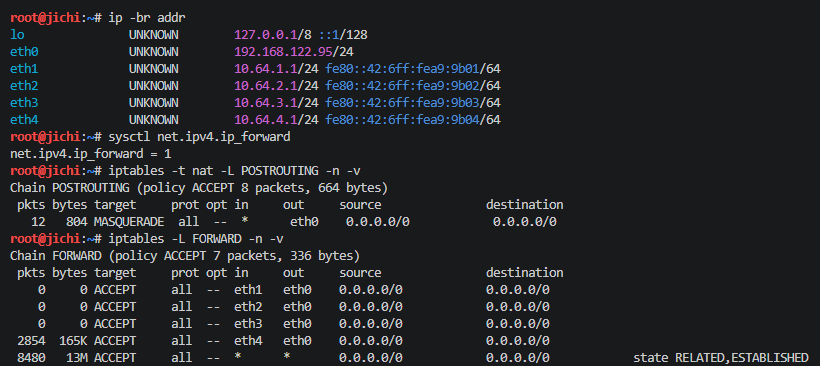

- Cek konektivitas ke gateway `jichi` dari `tengen`:

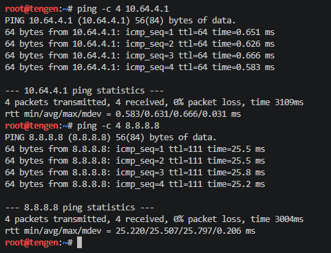

---

### 2. Konfigurasi DHCP Server pada tengen

Layanan `isc-dhcp-server` dipasang pada `tengen` (`10.64.4.10`). Karena interface `eth0` tengen berada di subnet `10.64.4.0/24`, deklarasi subnet lokal tanpa dynamic pool didefinisikan agar service tidak mengalami error *No subnet declaration*.

Interface yang mendengarkan paket ditentukan pada `/etc/default/isc-dhcp-server`:

```bash
INTERFACESv4="eth0"
INTERFACESv6=""
```

Deklarasi subnet lokal pada `/etc/dhcp/dhcpd.conf`:

```text
subnet 10.64.4.0 netmask 255.255.255.0 {
}
```

Script konfigurasi DHCP server dijalankan dari `nodes/tengen/quest-2.sh`:

```bash

Pengujian dilakukan dengan memeriksa status service `isc-dhcp-server` di tengen:

- Cek status service:

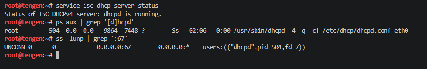

- Cek IP dari client `itadori`, `fushiguro`, `zenin`, `okkotsu`:

```bash
killall udhcpc 2>/dev/null
udhcpc -i eth0 -n -q
ip -br addr show eth0

# Expected output:
itadori   -> 10.64.2.10 - 10.64.2.35
fushiguro -> 10.64.2.10 - 10.64.2.35
zenin     -> 10.64.2.70 - 10.64.2.95
okkotsu   -> 10.64.2.70 - 10.64.2.95
```

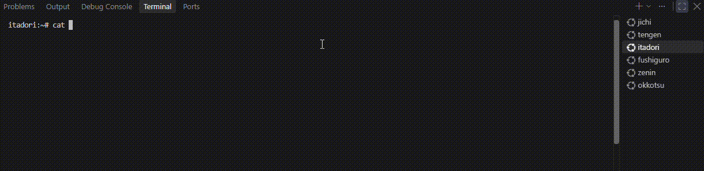

---

### 3. Konfigurasi DHCP Relay pada jichi

Karena request DHCP dikirim secara broadcast dan terhalang oleh router, `jichi` dikonfigurasi sebagai DHCP Relay menuju `tengen` (`10.64.4.10`). Relay mendengarkan request dari Network 2 (`eth2`) dan Network 3 (`eth3`), lalu meneruskannya melalui `eth4`.

Konfigurasi DHCP relay dijalankan dari `nodes/jichi/quest-3.sh`:

```bash
# Quest 3
apt-get update
apt-get install -y isc-dhcp-relay

cat <<EOF > /etc/default/isc-dhcp-relay
SERVERS="10.64.4.10"
INTERFACES="eth2 eth3 eth4"
OPTIONS=""
EOF

service isc-dhcp-relay restart
pkill dhcrelay 2>/dev/null || true
dhcrelay -4 -i eth2 -i eth3 -i eth4 10.64.4.10 >/var/log/dhcrelay.log 2>&1 &
```

Pengujian dilakukan dengan memastikan proses `dhcrelay` berjalan pada `jichi`:

- jichi relay status:

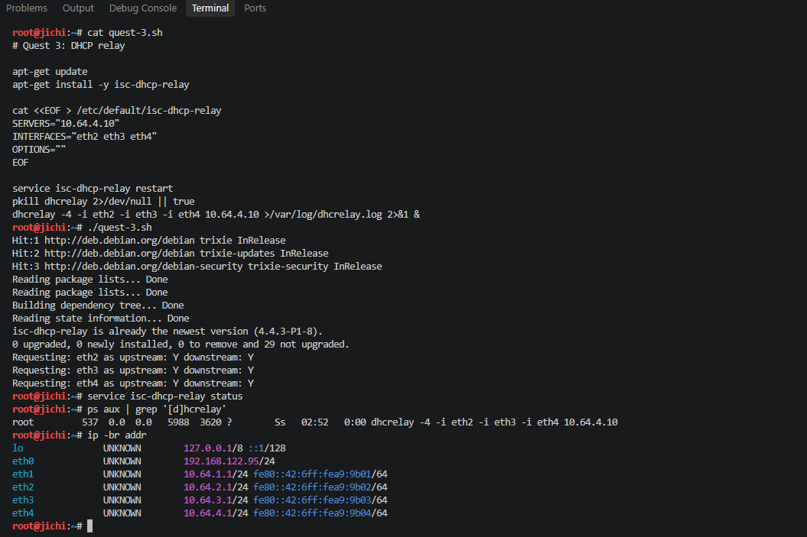

- Cek IP dari client `itadori (network 2)`, `ino (network 3)`:

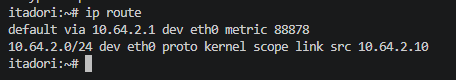

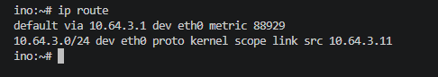

---

### 4. Pembagian Pool Network 2 Berdasarkan DHCP Class

Untuk memisahkan jatah alamat antara Dev Team (`itadori`, `fushiguro`) dan Support Team (`zenin`, `okkotsu`) di subnet yang sama (`10.64.2.0/24`), digunakan DHCP class berdasarkan MAC address. Rentang `10.64.2.36` sampai `10.64.2.69` sengaja tidak dialokasikan.

Konfigurasi kelas dan pool pada `/etc/dhcp/dhcpd.conf`:

```text
class "dev-team" {
    match if (
        hardware = 01:02:42:10:96:32:00 or
        hardware = 01:02:42:82:01:ad:00
    );
}

class "support-team" {
    match if (
        hardware = 01:02:42:03:be:c4:00 or
        hardware = 01:02:42:7a:e9:57:00
    );
}

subnet 10.64.2.0 netmask 255.255.255.0 {
    option routers 10.64.2.1;
    option broadcast-address 10.64.2.255;
    option domain-name-servers 10.64.1.2, 10.64.1.3;
    option domain-name "k01.com";

    pool {
        allow members of "dev-team";
        range 10.64.2.10 10.64.2.35;
    }

    pool {
        allow members of "support-team";
        range 10.64.2.70 10.64.2.95;
    }
}
```

Pengujian dilakukan dengan menjalankan `udhcpc` pada masing-masing client Network 2:


`itadori` memperoleh `10.64.2.10`, `fushiguro` memperoleh `10.64.2.11`, sedangkan `zenin` memperoleh `10.64.2.70` dan `okkotsu` memperoleh `10.64.2.71`.

---

### 5. Pengaturan Lease Time pada Network 3

Pada Network 3 (`10.64.3.0/24`), durasi sewa dibedakan antara short lease 30 menit (1800 detik) untuk `ino` dan `kusakabe`, serta long lease 12 jam (43200 detik) untuk `miwa`.

Konfigurasi pool pada `/etc/dhcp/dhcpd.conf`:

```text
class "short-lease-clients" {
    match if (
        hardware = 01:02:42:8c:dc:78:00 or
        hardware = 01:02:42:4b:2b:85:00
    );
}

class "long-lease-clients" {
    match if (
        hardware = 01:02:42:39:9b:53:00
    );
}

subnet 10.64.3.0 netmask 255.255.255.0 {
    option routers 10.64.3.1;
    option broadcast-address 10.64.3.255;
    option domain-name-servers 10.64.1.2, 10.64.1.3;
    option domain-name "k01.com";

    pool {
        allow members of "short-lease-clients";
        range 10.64.3.10 10.64.3.89;
        default-lease-time 1800;
        max-lease-time 1800;
    }

    pool {
        allow members of "long-lease-clients";
        range 10.64.3.100 10.64.3.199;
        default-lease-time 43200;
        max-lease-time 43200;
    }
}
```

Pengujian dilakukan dengan memeriksa output `udhcpc` saat perolehan lease:

- ino

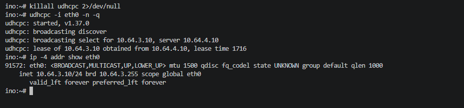

- kusakabe

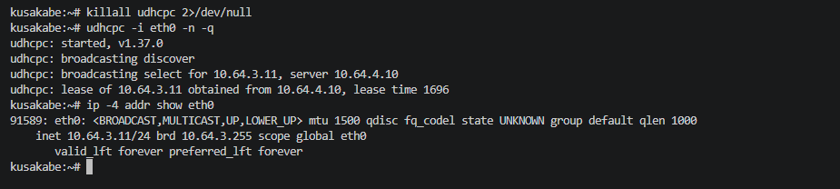

- miwa

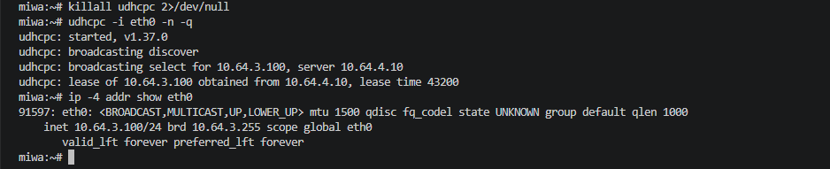

`ino` dan `kusakabe` memperoleh lease time 1800 detik pada rentang `.3.10–.3.89`, sedangkan `miwa` memperoleh lease time 43200 detik pada rentang `.3.100–.3.199`.

- verifikasi database lease pada `tengen`:

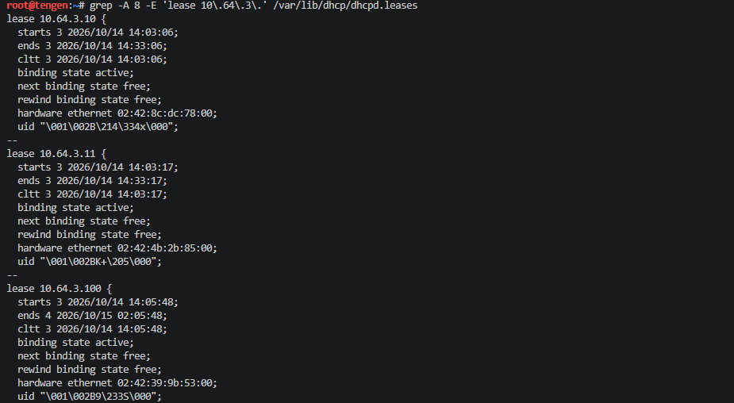

---

### 6. Fixed Address untuk Kugisaki

`kugisaki` ditetapkan sebagai host VIP yang menerima fixed address `10.64.3.99` berdasarkan MAC address `02:42:91:6d:8c:00`. Alamat ini berada di luar rentang pool dinamis short lease dan long lease.

Konfigurasi host pada `/etc/dhcp/dhcpd.conf`:

```text
host kugisaki {
    hardware ethernet 02:42:91:6d:8c:00;
    fixed-address 10.64.3.99;
    option routers 10.64.3.1;
    option domain-name-servers 10.64.1.2, 10.64.1.3;
    option domain-name "k01.com";
}
```

Pengujian dilakukan dengan memperbarui lease pada `kugisaki`:

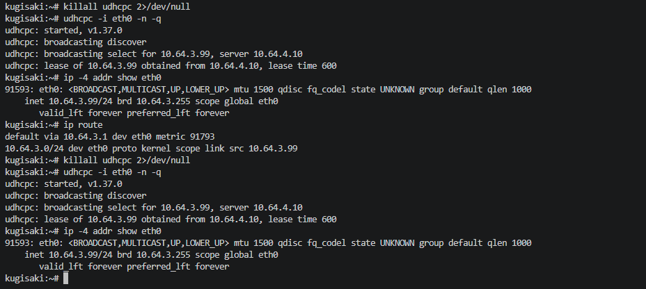

`kugisaki` selalu memperoleh alamat statis `10.64.3.99`.

---

### 7. Validasi Konfigurasi Jaringan Client dan Database Lease

Setiap client menerima parameter jaringan berupa netmask `/24`, default gateway ke router `jichi`, nameserver `10.64.1.2` dan `10.64.1.3`, serta domain search `k01.com`.

Konfigurasi pada client Alpine diatur pada `init.sh`:

```bash
cat <<EOF > /etc/network/interfaces
auto eth0
iface eth0 inet dhcp
EOF

killall udhcpc 2>/dev/null
udhcpc -i eth0 -n -q
```

Pemeriksaan dilakukan dengan melihat `ip route`, `/etc/resolv.conf` pada client, serta file `/var/lib/dhcp/dhcpd.leases` pada `tengen`:

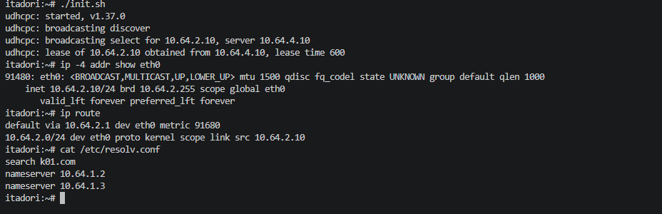


Database sewa mencatat seluruh client dengan IP, status binding aktif, dan waktu sewa yang sesuai tanpa ada alamat yang bertabrakan.

---

### 8. Analisis Paket Pertukaran DHCP (DORA)

Proses perolehan alamat diuji dengan menangkap paket DHCP pada interface `eth0` `tengen` menggunakan `tcpdump`:

```bash
tcpdump -i eth0 -n -vvv "port 67 or port 68"
```

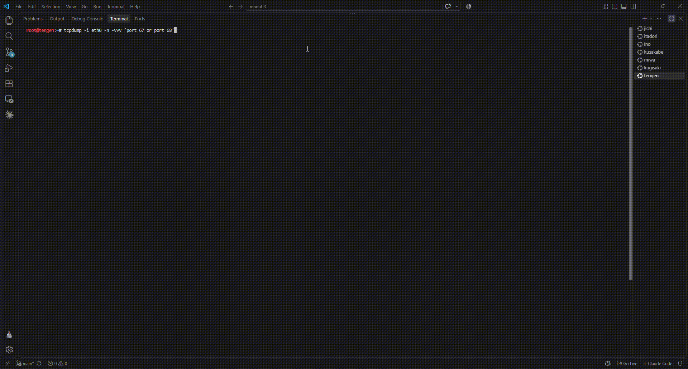

Hasil penangkapan paket menunjukkan urutan empat tahap:
1. **DHCPDISCOVER**: Klien meminta konfigurasi, diteruskan oleh relay `jichi` dengan field `giaddr = 10.64.2.1`.
2. **DHCPOFFER**: Server `tengen` menawarkan IP dari pool yang sesuai.
3. **DHCPREQUEST**: Klien meminta sewa resmi terhadap penawaran tersebut.
4. **DHCPACK**: Server mengonfirmasi dan memberikan lease beserta opsi jaringan.

---

### 9. Pengujian Gangguan dan Pemulihan DHCP Relay

Pengujian dilakukan untuk membuktikan dampak terputusnya jalur relay antara client dan server. Layanan relay pada `jichi` dihentikan sementara menggunakan `nodes/jichi/quest-9.sh stop`.

Saat relay berhenti, permintaan lease baru pada client mengalami kegagalan:

```text
udhcpc: started, v1.37.0
udhcpc: broadcasting discover
udhcpc: broadcasting discover
udhcpc failed to get a DHCP lease
udhcpc: no lease, failing
```

Setelah relay dipulihkan kembali menggunakan `nodes/jichi/quest-9.sh start`, client kembali dapat memperoleh lease sesuai pool asalnya beserta default gateway semula:

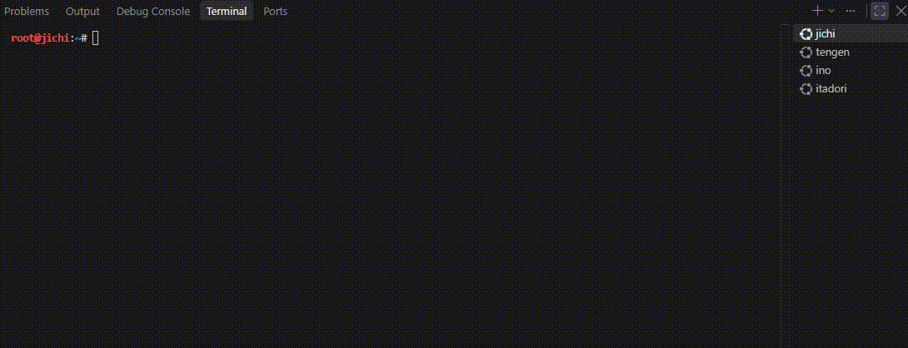

---

### 10. Autostart Layanan Pasca-Restart

Pada image GNS3 yang digunakan, `/root/init.sh` dikonfigurasi sebagai startup
script node. Karena itu, setelah `jichi` atau `tengen` direstart, `init.sh`
akan dijalankan otomatis.

Konfigurasi pada `nodes/jichi/init.sh` mengaktifkan kembali interface,
forwarding, NAT, dan DHCP relay. Konfigurasi pada `nodes/tengen/init.sh`
mengaktifkan kembali alamat IP serta DHCP server

Pengujian dilakukan dengan me-restart kedua node, kemudian memeriksa service:

```bash
# Pada jichi
ps aux | grep '[d]hcrelay'
sysctl net.ipv4.ip_forward

# Pada tengen
service isc-dhcp-server status
ps aux | grep '[d]hcpd'
```

Setelah kedua node direstart, seluruh interface, routing NAT, DHCP relay, dan
DHCP server kembali aktif secara otomatis tanpa perlu menjalankan script
tambahan.

- verifikasi status service setelah restart:

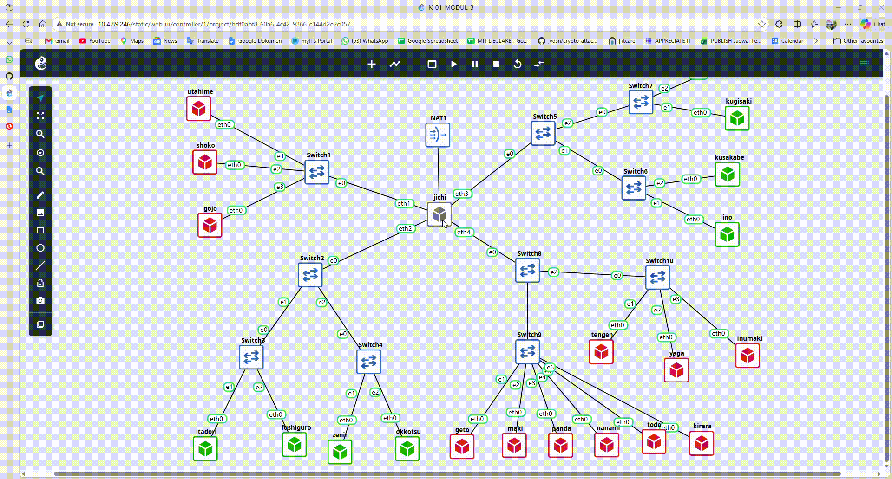